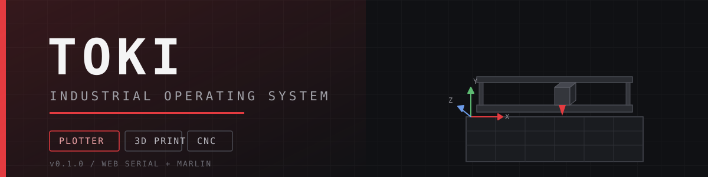
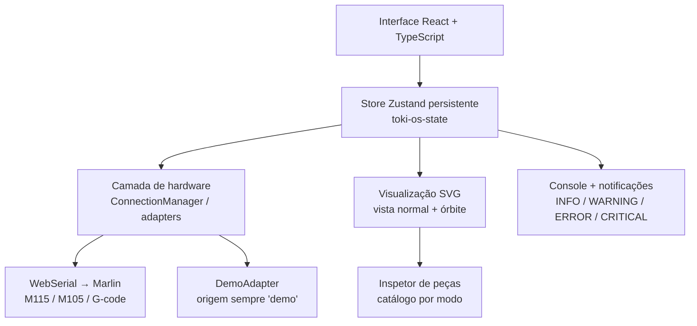

<div align="center">



[](https://github.com/tkmzj1bw/Toki/releases)
[](https://github.com/tkmzj1bw/Toki/actions/workflows/build.yml)


**Interface local para operar, inspecionar e organizar uma rig híbrida de plotter, impressão 3D e CNC.**

</div>

---

## Visão geral

O **TOKI** é um "sistema operacional industrial" em navegador: um painel único para desenhar, gerar G-code, comandar o movimento, acompanhar telemetria e inspecionar a máquina peça por peça.

Ele conversa com firmware **Marlin** por **WebSerial** e também oferece um **modo demo explicitamente identificado**, que nunca envia comando para hardware. Toda telemetria mostra sua origem (`demo` ou `hardware`); o estado do fuso é sempre *comandado*, nunca inventado como medição.

> [!IMPORTANT]
> Esta é uma interface de operação, não um substituto de manual, desenho técnico ou procedimento de segurança. Nenhuma proteção física ou do firmware é burlada pelo software.

---

## Download rápido

Quer só usar? Baixe a [release v0.1.0](https://github.com/tkmzj1bw/Toki/releases/tag/v0.1.0):

| Arquivo | Para que serve |
| --- | --- |
| [`TOKI-v0.1.0-web.zip`](https://github.com/tkmzj1bw/Toki/releases/download/v0.1.0/TOKI-v0.1.0-web.zip) | Build estático pronto — extraia e abra `index.html` |
| [`TOKI-v0.1.0-source.zip`](https://github.com/tkmzj1bw/Toki/releases/download/v0.1.0/TOKI-v0.1.0-source.zip) | Código-fonte para compilar |
| [`SHA256SUMS.txt`](https://github.com/tkmzj1bw/Toki/releases/download/v0.1.0/SHA256SUMS.txt) | Conferência de integridade |

O build usa caminhos relativos, então funciona em `file://` ou em qualquer subpasta de um servidor estático. **WebSerial exige Chrome/Edge em `localhost` ou HTTPS** — o modo demo funciona em qualquer navegador moderno.

---

## Rodando do código

Requisitos: **Node.js 20 LTS** e **npm**.

```bash
git clone https://github.com/tkmzj1bw/Toki.git
cd Toki
npm install
npm run dev
```

Abra `http://localhost:5173/`.

| Comando | O que faz |
| --- | --- |
| `npm run dev` | Servidor de desenvolvimento com HMR |
| `npm run build` | Checagem de tipos + build de produção em `dist/` |
| `npm run preview` | Serve o build de produção localmente |
| `npm run typecheck` | Apenas TypeScript, sem gerar arquivos |

Prefere sem instalar nada? Use **GitHub Codespaces**: `Code → Codespaces → Create codespace on main` e rode `npm install && npm run dev` no VS Code do navegador.

---

## Os seis módulos

| # | Módulo | Função |
| --- | --- | --- |
| 01 | **OVERVIEW** | Painel central: estado da rig, posição, atividade e visualização da máquina |
| 02 | **PLOT STUDIO** | Editor vetorial, camadas, importação de SVG, parâmetros e exportação de G-code |
| 03 | **MACHINE CTRL** | Jog, homing, comandos diretos validados e controles específicos por ferramenta |
| 04 | **MONITORING** | Telemetria com origem explícita, gráficos de eventos e console |
| 05 | **PROJECTS** | Projetos locais, estados de execução e acompanhamento |
| 06 | **SYSTEM CENTER** | Preferências, conexão, perfil da rig e confirmações de segurança |

O shell mantém sidebar persistente, header com conexão/estado/notificações/relogio e console inferior com níveis `INFO / WARNING / ERROR / CRITICAL`.

---

## Uma rig, três ferramentas

A troca de modo é protegida: durante execução ela é bloqueada, exige confirmação explícita e pede estacionamento em Z seguro.

| Modo | Ferramenta | Leito | Limites de avanço | Z seguro |
| --- | --- | --- | --- | --- |
| **PEN PLOTTER** | Caneta técnica 0,5 mm | 300 × 300 mm | 6.000 / 9.000 mm/min | 5 mm |
| **IMPRESSORA 3D** | Hotend direta, bico 0,4 mm | 300 × 300 mm | 12.000 / 18.000 mm/min | 10 mm |
| **CNC / FUSO** | Fuso 300 W, collet 3,175 mm | 300 × 300 mm | 3.000 / 6.000 mm/min | 15 mm |

O perfil CNC vai de **3.000 a 12.000 RPM** (padrão 8.000), mas `spindleEnabled` começa desligado. O modo 3D usa bico até 260 °C e mesa até 110 °C, com consulta `M105` periódica quando conectado.

---

## Olhando cada parte da máquina

A visualização é um SVG customizado com **vista normal (planta) por padrão**: eixos **XYZ** na origem e cabeçote com volume 3D em todos os modos.

No **Inspetor de peças** você pode:

- clicar em qualquer componente do modelo ou escolher na lista lateral;
- buscar e filtrar por sistema (estrutura, movimento, ferramenta);
- ver ficha técnica com código, descrição e especificação contextual;
- aplicar zoom, vista explodida e realce;
- alternar para **Órbite 3D**, com arraste, rotação, inclinação e presets `ISO / FRENTE / LATERAL / TOPO`.

O catálogo muda conforme a ferramenta ativa — hotend, fuso/coleta/broca ou caneta.

<details>
<summary><b>Como abrir o inspetor</b></summary>

Em Overview, Plot Studio, Machine Control, Monitoring ou Project Manager, clique em **INSPECIONAR PEÇAS** no cabeçalho da visualização.

</details>

---

## Segurança por design

- Nenhum comando é enviado antes de uma conexão confirmada por `M115`.
- Comandos diretos passam por **allowlist** e validação de envelope, feed rate e parâmetros.
- `E` só existe na impressora 3D, exige `thermalRunaway` confirmado e, em hardware, leitura `M105` com bico ≥ 180 °C.
- `M104/M109/M140/M190` acima de 60 °C exigem confirmação de `thermal runaway`.
- `M3/M4/M5` exigem `spindleEnabled`, firmware compatível, envelope fechado e peça fixada.
- Troca de modo, cooldown e parada do fuso têm confirmação explícita em diálogo dedicado.
- Projetos concluídos só viram `completed_real` com confirmação; simulações são marcadas como `completed_virtual`.

---

## Arquitetura



```text
src/
├── components/
│   ├── layout/     shell, boot, welcome, console, header, sidebar, diálogos
│   ├── rig/        seletor de modo e painel de segurança da rig
│   ├── ui/         ícones e primitivas visuais
│   └── viz/        Machine3D, MachineInspector, PlotCanvas, gráficos
├── hardware/       WebSerial, MarlinAdapter, DemoAdapter, allowlist de comandos
├── lib/            geometria, G-code, SVG, defaults, utilidades
├── modules/        seis módulos da interface
├── store/          estado global persistente e intertravamentos
├── styles/         design system e responsividade
└── types/          modelos de domínio
```

---

## Estado atual

- [x] Shell completo, boot/welcome, console e notificações
- [x] Seis módulos funcionais
- [x] Rig híbrida com perfis e intertravamentos
- [x] Inspetor de peças com órbita e vista explodida
- [x] Build estático publicado na release `v0.1.0`
- [x] CI de build no GitHub Actions
- [ ] Integração contínua publicando releases automaticamente
- [ ] Mais testes automatizados de comandos e G-code

---

## Licença

Ainda não definida pelo mantenedor. Enquanto isso, o código pode ser consultado e usado como referência; para redistribuição, entre em contato pelo repositório.

---

<div align="center">

Feito para a bancada, não para o slide. ⚙️

[↑ Voltar ao topo](#visão-geral)

</div>
